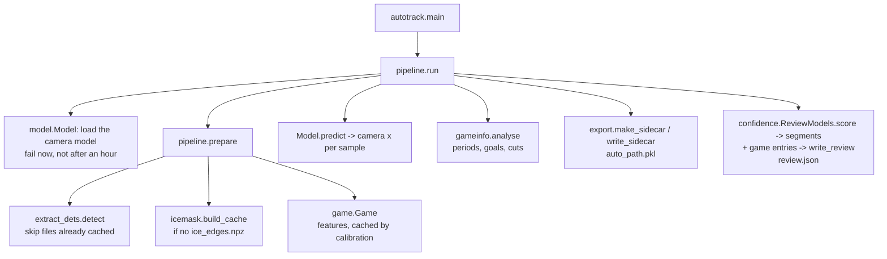

# Autotrack: a code tour

This document follows the code **in the order it runs**. It's the companion to the two concept
documents:

- [How autotrack works](autotrack-explained.md): *what* each step does and why, with pictures.
  Links below marked **📖** point to the relevant section.
- [LightGBM in autotrack](lightgbm-explained.md): the model in depth. Marked **🌲**.

Line numbers are as of commit `db358af` on `main`, plus these docs. They drift as the code
changes; the function names are the stable reference. Links open the file at that line in VS Code
or on GitHub.

---

## 1. The map

Two programs share the code:
- **`autotrack.py`** runs offline over a folder and writes `auto_path.pkl` and `review.json`.
- **`sportscam.py`**, your app, reads those files for review and rendering.

| File | Role | Concepts |
|---|---|---|
| [autotrack.py](../autotrack.py) | command line: `DIR` or `train DIR...` | |
| [af/pipeline.py](../af/pipeline.py) | the steps, in order: `prepare`, `run`, `train` | 📖 [big picture](autotrack-explained.md#the-big-picture) |
| [af/calibration.py](../af/calibration.py) | which videos make up a game; calibration (game pkl or defaults) | 📖 [step 5](autotrack-explained.md#step-5-writing-the-camera-path) |
| [af/geometry.py](../af/geometry.py) | the app's crop maths; band column → camera x | 📖 [step 0](autotrack-explained.md#step-0-what-camera-x-means) |
| [af/extract_dets.py](../af/extract_dets.py) | decode + rotate + YOLO + proxy video | 📖 [step 1](autotrack-explained.md#step-1-find-the-people) |
| [af/icemask.py](../af/icemask.py) | median frame → boards lines | 📖 [step 2](autotrack-explained.md#step-2-the-ice-mask-or-which-people-count) |
| [af/players.py](../af/players.py) | loads detections; the on-ice rule; per-sample skater x | 📖 [step 2](autotrack-explained.md#step-2-the-ice-mask-or-which-people-count) |
| [af/motion.py](../af/motion.py) | skater speeds by frame-to-frame matching; rush features | 📖 [step 3](autotrack-explained.md#step-3-from-skaters-to-where-is-the-play) |
| [af/features.py](../af/features.py) | the 167 features | 📖 [step 3](autotrack-explained.md#step-3-from-skaters-to-where-is-the-play) |
| [af/game.py](../af/game.py) | one game: calibration + detections + features (+ labels if hand-tracked) | |
| [af/model.py](../af/model.py) | the camera LightGBM model: fit, save, load, predict | 📖 [step 4](autotrack-explained.md#step-4-the-learned-model-or-what-would-you-do-here), 🌲 |
| [af/confidence.py](../af/confidence.py) | review models (quantile, ensemble, error, live); segments | 📖 [step 6](autotrack-explained.md#step-6-confidence-or-where-to-spend-your-review-time), 🌲 [§10](lightgbm-explained.md#10-the-other-lightgbm-models-in-autotrack) |
| [af/scoreboard.py](../af/scoreboard.py) | finds the clock; reads digit crops; clock running; score steps | 📖 [step 7](autotrack-explained.md#step-7-periods-goals-and-cuts) |
| [af/events.py](../af/events.py) | faceoffs, goals from play, intermissions | 📖 [step 7](autotrack-explained.md#step-7-periods-goals-and-cuts) |
| [af/gameinfo.py](../af/gameinfo.py) | combines board + play into periods, goals, cuts | 📖 [step 7](autotrack-explained.md#step-7-periods-goals-and-cuts) |
| [af/export.py](../af/export.py) | writes `auto_path.pkl` and `review.json` | 📖 [step 5](autotrack-explained.md#step-5-writing-the-camera-path) |
| [sportscam.py](../sportscam.py) | the app: menu, copy-in/refresh, review keys, render loop | 📖 [step 6](autotrack-explained.md#step-6-confidence-or-where-to-spend-your-review-time) |
| [review.py](../review.py) | review session (tiers, navigation, drawing), path refresh, goal edits | |
| [camerapath.py](../camerapath.py), [cameratarget.py](../cameratarget.py) | the camera path data model, shared by both programs | |
| [af/human.py](../af/human.py), [af/metrics.py](../af/metrics.py) | hand-tracked paths as test data; scoring | 🌲 [§8](lightgbm-explained.md#8-testing-it-honestly-and-a-hint-for-improvement) |

---

## 2. `python autotrack.py DIR`

### 2.1 Entry: `autotrack.main` → `pipeline.run`

[autotrack.py:22](../autotrack.py#L22) parses the arguments and calls
[`pipeline.run(dir, cache, model)`](../af/pipeline.py#L68).

The first thing `run` does is load the camera model with
[`model.Model`](../af/model.py#L46). That way a missing or out-of-date model file fails at once,
not after 50 minutes of detection.

### 2.2 `prepare`: detection, ice mask, features

[`pipeline.prepare`](../af/pipeline.py#L29) runs these in order:

1. **Which videos, which calibration.**
   - [`calibration.video_files`](../af/calibration.py#L29) lists the `.mp4` files the way the app
     orders them, skipping `_processed`.
   - [`calibration.load_calibration`](../af/calibration.py#L49) reads `<first video>.pkl` if it
     exists, otherwise uses [`DEFAULTS`](../af/calibration.py#L24).
2. **Detection:** [`extract_dets.detect`](../af/extract_dets.py#L71), for each video file:
   - Skip it if `dets/<stem>.npz` already exists. This is what makes re-runs and resumes cheap.
   - A reader thread ([`reader`](../af/extract_dets.py#L54)) runs ffmpeg with the GPU decoder,
     keeps every 5th frame (`select=not(mod(n,5))`), and queues the raw frames.
   - Each frame is rotated by `rotation` and only the band rows are kept, in a single
     `cv2.warpAffine` using [`band_matrix`](../af/extract_dets.py#L43) and
     [`ROT_BAND`](../af/extract_dets.py#L30) = rows 1550–2600.
   - YOLO runs on the band: `model.predict(band, imgsz≈4800, classes=[0], conf=0.10,
     quantize=16)`, people only, half precision. Box y values are shifted back to rotated-frame
     rows.
   - A second ffmpeg writes the half-size band to `<stem>_band.mp4`, the proxy.
   - The results go to `dets/<stem>.npz`: `times_ms`, `counts`, `boxes`, `confs`. A file that
     decodes no frames is refused rather than cached as empty.
   - `meta.json` records the files, their start times on the app's timeline, the band and the
     rotation.
   - The YOLO weights are fetched lazily by [`ensure_weights`](../af/pipeline.py#L20), only if a
     file actually needs detecting.

   📖 [Step 1](autotrack-explained.md#step-1-find-the-people)

3. **Ice mask**, only if `icemask/ice_edges.npz` is missing:
   [`icemask.build_cache`](../af/icemask.py#L96) runs on the longest video file.
   - [`sample_band_frames`](../af/icemask.py#L21) takes 31 frames.
   - [`build`](../af/icemask.py#L51) takes the per-pixel median, picks bright low-saturation
     pixels, and keeps the largest connected region. It measures the top and bottom of that
     region per column, fits outer envelope curves ([`_envelope`](../af/icemask.py#L36)), and
     extends them past the nets.
   - It saves `top`, `bot` and `band0`, plus three preview images.

   📖 [Step 2](autotrack-explained.md#step-2-the-ice-mask-or-which-people-count)

4. **Features:** [`game.Game`](../af/game.py#L25), see 2.3.

### 2.3 `Game`: one game's samples, features and labels

[`Game.__init__`](../af/game.py#L26):

1. Loads `meta.json`, the calibration, and `max_x`
   ([`geometry.max_x`](../af/geometry.py#L21); 2819 for this rink).
2. **Hand-tracked?** If the game pkl's camera path is *mostly recorded* rather than auto, it
   becomes `self.human` ([`HumanPath`](../af/human.py#L27)) and provides labels for training and
   scoring. A path under review (mostly auto) is deliberately not treated as labels.
3. **Feature cache:** if `features.npz` exists *and* was built with the same calibration
   ([`calib_key`](../af/calibration.py#L57)), it's loaded and the step is done. A calibration
   change makes it rebuild, because calibration moves every camera x.
4. Otherwise it builds the features:
   - [`players.Detections`](../af/players.py#L19) loads all the boxes. It's given a
     [`geometry.ColToX`](../af/geometry.py#L58), which inverts the app's crop geometry, so that
     "column in the band" becomes "camera x centred on this skater"
     ([`col_to_x`](../af/players.py#L46)).
   - [`Detections.on_ice`](../af/players.py#L51) applies the on-ice rule: feet between the
     boards lines (with slack), confidence ≥ 0.25, height ≥ 20 px.
   - [`Detections.per_sample`](../af/players.py#L62) gives a list per sample of skater camera x.
   - [`motion.velocities`](../af/motion.py#L26) matches each skater to the next sample by
     minimum-cost assignment (Hungarian, 160 px cutoff). That gives their x speed.
     [`motion.summarise`](../af/motion.py#L44) turns those into 10 motion and rush-front numbers
     per sample.
   - [`features.build_features`](../af/features.py#L51) produces percentiles, histogram and
     count, smoothed over 1 s, then the same at
     [`OFFSETS_S`](../af/features.py#L14) = ±1, 2, 4, 8 s, plus velocities, 10 s and 20 s
     averages, and the motion features at ±1, 2, 4 s. That's **167 columns**, with names.
   - It saves `t`, `X`, `names`, `med` (the median skater) and `calib` to `features.npz`.
5. [`_labels`](../af/game.py#L62): if hand-tracked, sets `y` (your camera x on samples you were
   framing), `use` (which samples count) and `sid` (which framed stretch, for grouped testing).

📖 [Step 3](autotrack-explained.md#step-3-from-skaters-to-where-is-the-play)

### 2.4 Camera x

[`Model.predict`](../af/model.py#L54) checks that the feature names match what the model was
trained on. It calls LightGBM's `booster.predict(X)`, then [`finish`](../af/model.py#L27): clip
to 0…max_x and average over 2 s ([`SMOOTH_S`](../af/model.py#L18)).

📖 [Step 4](autotrack-explained.md#step-4-the-learned-model-or-what-would-you-do-here) ·
🌲 [§2](lightgbm-explained.md#2-one-decision-tree)–[§3](lightgbm-explained.md#3-boosting-many-small-trees-each-fixing-the-last-ones-mistakes)

### 2.5 Periods, goals, cuts: `gameinfo.analyse`

[`gameinfo.analyse(g, pred)`](../af/gameinfo.py#L91) is wrapped in a `try` inside `run`, so a
failure there never costs you the camera path. Its steps:

1. [`board(g)`](../af/gameinfo.py#L38): the scoreboard crops, cached in `scoreboard.npz`.
   Otherwise:
   - [`scoreboard.locate_clock`](../af/scoreboard.py#L61) looks over 3 minutes of the proxy in the
     [`SEARCH`](../af/scoreboard.py#L24) window. The clock is where pixels change with a strong
     1 Hz rhythm.
   - [`scoreboard.read_game`](../af/scoreboard.py#L83) extracts the clock, home and away crops for
     every sample, at the fixed offsets [`CLOCK_BOX` / `HOME_DIGIT` /
     `AWAY_DIGIT`](../af/scoreboard.py#L26).
2. **Periods:**
   - [`board_periods`](../af/gameinfo.py#L52): [`scoreboard.clock_running`](../af/scoreboard.py#L121)
     (the 1 s change above half the running level), keeping runs with ≥ 9 skaters, bridging gaps
     under [`BRIDGE_S`](../af/gameinfo.py#L29), and requiring at least
     [`MIN_PERIOD_S`](../af/gameinfo.py#L28).
   - Fallback if there are fewer than 2 periods: [`play_periods`](../af/gameinfo.py#L70) uses
     [`events.intermissions`](../af/events.py#L101), stretches of nearly empty ice.
3. **Board goals:** [`scoreboard.steps`](../af/scoreboard.py#L97) for each side, a lasting change
   in the most-changed quarter of the digit pixels. Only those inside the game window and below
   [`BOARD_RESET`](../af/scoreboard.py#L33) count.
4. **Play goals:** [`events.goals`](../af/events.py#L61). It takes the centre faceoffs from
   [`events.faceoffs`](../af/events.py#L37) (stillness, a tight group, then release), drops
   period openers, and requires play in an end zone in the minute before.
5. **Match and vote:**
   - Board goals within [`MATCH_S`](../af/gameinfo.py#L30) of a play goal are "confirmed".
   - Home/away is mapped to the app's score[0]/score[1] by majority vote over confirmed goals,
     using [`team_of_end`](../af/gameinfo.py#L85) (the app's left/right rule plus the period-2
     swap).
   - Unexplained centre faceoffs and cut suggestions (the gaps between periods) are collected.
6. It returns `{board_ok, periods, goals, scored, centre_faceoffs, cuts, …}`.

📖 [Step 7](autotrack-explained.md#step-7-periods-goals-and-cuts)

### 2.6 Writing `auto_path.pkl`

[`export.make_sidecar`](../af/export.py#L28):
- builds one camera point per second, with y from the calibration as the app computes it, and
  `source="auto"`;
- puts period and score on every point's `game_state`;
- adds `goal a-b` and `period - N` bookmarks;
- stores the calibration keys and an `autotrack` info dict, including `created`, which the app
  uses to spot re-runs.

[`write_sidecar`](../af/export.py#L63) writes to a temp file and renames it into place, so a crash
can't leave a half-written file.

📖 [Step 5](autotrack-explained.md#step-5-writing-the-camera-path)

### 2.7 Writing `review.json`

1. [`pipeline.game_entries`](../af/pipeline.py#L48) creates `goal`, `faceoff` and `cut` entries
   from `analyse`. Confirmed goals are left out when the board worked.
2. [`ReviewModels.load`](../af/confidence.py#L107) loads `models/review_*.txt`, then
   [`ReviewModels.score`](../af/confidence.py#L86) runs:
   - [`SignalModels.signals`](../af/confidence.py#L61): quantile spread, ensemble disagreement,
     path speed, skater evidence, and all 167 features;
   - the error model gives the expected error, and the live model gives P(live);
   - score = error × live.
3. [`segments`](../af/confidence.py#L164) applies the top-20% threshold, merging, padding and
   ranking. [`describe`](../af/confidence.py#L203) picks each segment's reason.
4. [`export.write_review`](../af/export.py#L72) writes the JSON. Tiers are *not* decided here; the
   app works them out after you set the start.

If the folder's own pkl is hand-tracked, `run` finally prints the score against it
([`metrics.evaluate`](../af/metrics.py#L20)).

📖 [Step 6](autotrack-explained.md#step-6-confidence-or-where-to-spend-your-review-time)

---

## 3. `python autotrack.py train DIR [DIR ...]`

[`pipeline.train`](../af/pipeline.py#L109):

1. Runs `prepare` on every folder; `DIR=CACHE` uses a cache stored elsewhere. This is detection
   for any folder without a cache.
2. [`model.train`](../af/model.py#L32): keeps games with labels and stacks every `use` sample, then
   [`model.fit`](../af/model.py#L23) runs LightGBM with [`PARAMS`](../af/model.py#L16).
   [`model.save`](../af/model.py#L39) writes `models/autotrack_lgbm.txt` plus a `.json` with the
   feature names and which folders were used.
3. [`confidence.train`](../af/confidence.py#L152) builds the review models (it needs at least two
   hand-tracked games):
   - [`cross_game_signals`](../af/confidence.py#L128): for each game, camera and signal models are
     trained on the *other* games, giving honest errors;
   - [`fit_err_live`](../af/confidence.py#L141): the error model (L2) on those errors, and the
     live-play classifier on "were you framing";
   - the final signal models are fitted on all games, then
     [`ReviewModels.save`](../af/confidence.py#L97).

🌲 [§5 settings](lightgbm-explained.md#5-the-settings-one-by-one) ·
[§10 the other models](lightgbm-explained.md#10-the-other-lightgbm-models-in-autotrack) ·
[§11 retraining](lightgbm-explained.md#11-retraining)

---

## 4. The files on disk

| File | Written by | Contents |
|---|---|---|
| `autotrack_cache/dets/<stem>.npz` | `detect` | `times_ms` (n samples), `counts` (boxes per sample), `boxes` (x0, y0, x1, y1 in rotated-frame px), `confs` |
| `autotrack_cache/dets/<stem>_band.mp4` | `detect` | half-res band at 5 fps: debug images, scoreboard |
| `autotrack_cache/dets/meta.json` | `detect` | files with `base_ms` (timeline offsets), band, rotation, stride |
| `autotrack_cache/icemask/ice_edges.npz` | `build_cache` | `top`, `bot` (boards lines per column), `band0` |
| `autotrack_cache/features.npz` | `Game` | `t`, `X` (n × 167), `names`, `med`, `calib` (cache key) |
| `autotrack_cache/scoreboard.npz` | `gameinfo.board` | `origin` (clock position) and the `home`, `away`, `clock` crop stacks |
| `DIR/auto_path.pkl` | `make_sidecar` | calibration keys, `camera_path` (auto points with `game_state`), `bookmark_times_ms`, `autotrack` (info, `created`) |
| `DIR/review.json` | `write_review` | `entries`: `kind` (camera/goal/faceoff/cut), `t0`, `t1`, `reason`, plus kind-specific fields (`expected_px`, `live`, `t`, `team`, `scored`) |
| game pkl, new keys | the app | `review_done` (t0 of reviewed entries), `review_goal_changes` (t, team, ±1), `auto_path_created` |
| `CameraTarget.source` | both | `"auto"`, `"human"` (recorded; the first marks the start) or `"review"` (review fixes and markers) |

---

## 5. The app side: `sportscam.py`

### 5.1 Start-up

Module level, top to bottom:
1. argparse, including `--review` and `--edit`.
2. If no mode flag was given, [`start_menu`](../sportscam.py#L178) runs
   ([sportscam.py:259](../sportscam.py#L259)). It summarises the folder. With no game pkl yet it offers only
   "Calibrate the camera" (edit / record; quitting saves the pkl). Otherwise the options are run
   autotrack, review, edit / record, render, convert; it sets `review_mode` or `writeOutputFile`
   from your choice. It runs autotrack as a subprocess, or
   [`convert_render`](../sportscam.py#L154) (the `convert.bat` equivalent), and loops back.
3. `show_keys()`, `load_logo()`, then [`examine_files`](../sportscam.py#L1171), which creates a
   `Processor` and calls `process()`.

### 5.2 `Processor.__init__`: which camera path to use

[sportscam.py:266](../sportscam.py#L266):
1. Load the game pkl: calibration, camera path, highlights, bookmarks, and the review state
   (`review_done`, `review_goal_changes`, `auto_path_created`).
2. **Sidecar** ([sportscam.py:318](../sportscam.py#L318)):
   - **No camera points:** copy `auto_path.pkl`'s path in, with its bookmarks, and its
     calibration if there was no game pkl.
   - **An auto path, and the sidecar's `created` differs:** back up to `.pkl.before-refresh`, then
     [`review.refresh_path`](../review.py#L75). That takes the new path and re-inserts every
     non-auto point, re-applies cuts and the end, and replays goal changes. Goals typed into the
     older app are recovered by [`legacy_goal_changes`](../review.py#L48), minus any the new path
     already has ([`drop_known_goals`](../review.py#L61)). Goal bookmarks are rebuilt by
     [`goal_bookmarks`](../review.py#L36).
   - **Only a start marker** (the one point placed while calibrating, and never an auto path):
     the auto path is copied in and that point kept as the start of play. More than one recorded
     point asks first, backing up to `.pkl.before-auto`.
   - **A path you recorded:** left alone.
3. With `--review`, [`start_review`](../sportscam.py#L382) creates a
   [`ReviewSession`](../review.py#L106) and marks cut entries already covered by a cut as done.

### 5.3 `process()`: the frame loop

[sportscam.py:834](../sportscam.py#L834), once per frame:

1. Read a frame, or reuse the last one when paused.
2. [`CameraPath.get_camera_at_time`](../camerapath.py#L71) returns the interpolated camera,
   eased when the direction changes, plus the current and next points. The display score and
   period come from the next point's `game_state`
   ([sportscam.py:890](../sportscam.py#L890)).
3. **Render end:** when rendering and past the last camera point, the logo wipe plays and the
   render finishes. That's why `Y` (end) works: it makes your end marker the last point.
4. **Start jump** on the first frame ([sportscam.py:931](../sportscam.py#L931)): jump to
   [`CameraPath.get_start_time`](../camerapath.py#L58), which is the first `"human"` point on a
   path that mixes auto and recorded points, otherwise the first point.
5. **Cuts** ([sportscam.py:973](../sportscam.py#L973)): at a point with `cut_to`, wipe and jump to
   the next point. Review-mode cuts work this way.
6. **Recording** ([sportscam.py:982](../sportscam.py#L982)):
   - **Normal mode:** `add_camera_target`, which truncates everything after (unchanged
     behaviour).
   - **Review mode:** [`CameraPath.replace_range`](../camerapath.py#L43) replaces only the time
     covered: from `record_from` up to now while `a` is on, or ±0.5 s for a single click. The new
     point is `source="review"`.
   - **Middle click in review:** [`adjust_goal`](../sportscam.py#L489) instead, which applies to
     every later point and records the change. It doesn't move the camera.
7. **Review auto-pause** ([sportscam.py:1021](../sportscam.py#L1021)): pause 1 s after the current
   segment ends.
8. Build the output frame (crop, mini scoreboard, period/score overlay). Then either write it to
   the render file, or draw the big window with the status lines and, in review mode,
   [`status_lines`](../review.py#L167) and [`draw_timeline`](../review.py#L189).
9. `waitKey` → [`handle_keys`](../sportscam.py#L573). `R` toggles review mode. In review mode
   [`handle_review_keys`](../sportscam.py#L496) gets the key first: `=`/`-` step,
   Enter/Backspace decide, `T`/`Y`/`c` mark, `a` records, `[ { ] }` change the score.
   Anything it doesn't handle falls through to the normal keys.
10. On quit, [`save_pickle`](../sportscam.py#L407) writes the game pkl, including the review keys.

### 5.4 The review session: `review.py`

- [`tiered`](../review.py#L120): entries between the start and end. Events (goal, faceoff, cut)
  always go first; camera segments fill 5, 5 and 10-minute budgets in rank order, then are sorted
  by time within each tier.
- [`step`](../review.py#L135): next unreviewed entry (`=`) or previous (`-`).
  [`accept`](../review.py#L151) marks it done.
- [`progress`](../review.py#L155) gives the per-tier counts shown in the status line.

### 5.5 The data model: `camerapath.py`

- [`camera_index`](../camerapath.py#L52): bisect over the times (it used to be a linear scan; a
  test checks they give identical results).
- [`replace_range`](../camerapath.py#L43): swap the points in [t0, t1] for new ones.
- [`get_start_time`](../camerapath.py#L58): the start rule above.
- `CameraTarget.source` ([cameratarget.py:11](../cameratarget.py#L11)): defaults to `"human"`.
  Old pickles without the field are read with `getattr(c, "source", "human")`.

---

## 6. Development and evaluation tools

These all take `DIR` or `DIR=CACHE`, and need hand-tracked games where noted.

| Command | What it shows | Concepts |
|---|---|---|
| `python -m af.transfer DIR DIR …` (hand-tracked) | baselines, within-game CV, train-on-other-game scores | 🌲 [§8](lightgbm-explained.md#8-testing-it-honestly-and-a-hint-for-improvement) |
| `python -m af.confidence DIR DIR …` (hand-tracked) | the review curve: minutes reviewed against error left | 📖 [step 6](autotrack-explained.md#step-6-confidence-or-where-to-spend-your-review-time) |
| `python -m af.gameinfo DIR …` | periods, goals with status, cuts; compares with the operator's goals if hand-tracked | 📖 [step 7](autotrack-explained.md#step-7-periods-goals-and-cuts) |
| `python -m af.events DIR …` (hand-tracked) | faceoffs against your restarts; goals found from play alone | |
| `python -m af.scoreboard DIR …` | clock position, score steps per side | |
| `python -m af.compare PRED.npz OUT.mp4 START DUR --game DIR` (hand-tracked) | side-by-side video, your crop over the auto crop | |
| `python -m af.debugvid OUT.mp4 START END --game DIR` | proxy video with kept/ignored boxes, boards lines, crops | |
| `af/clock.py`, `af/phases.py` | the first clock signal and cut planner; superseded by `scoreboard`/`gameinfo`, kept for reference | |

Tests (`python -m pytest tests/test_autotrack.py tests/test_camerapath.py tests/test_review.py
tests/test_refresh.py`) cover:
- the geometry round trip;
- the sidecar format and game info;
- the bisect lookup;
- `replace_range` and the start rule;
- tiers and ordering;
- refresh keeping edits and goals.

`tests/test_fused_roi.py` was already failing on `main` before this work.

---

## 7. Where to change things

| To change… | Edit |
|---|---|
| detection rate, confidence floor | `detect(stride=5, conf=0.10)` in [extract_dets.py](../af/extract_dets.py#L71) (then delete `dets/` to re-run) |
| the detection band | [`ROT_BAND`](../af/extract_dets.py#L30) (re-run detection) |
| who counts as on the ice | [`Detections.on_ice`](../af/players.py#L51) arguments (the features rebuild) |
| features | [`build_features`](../af/features.py#L51), [`summarise`](../af/motion.py#L44) (then **retrain**: the model checks the feature names) |
| model settings, smoothing | [`PARAMS`, `SMOOTH_S`](../af/model.py#L16) (then retrain) |
| review segment shape | [`SEG_*`](../af/confidence.py#L34) |
| review tier lengths | [`TIER_BUDGET_S`](../review.py#L15) |
| score-change sensitivity | [`MIN_STEP`, `BOARD_RESET`, `STEP_S`](../af/scoreboard.py#L29) |
| scoreboard position (another rink) | [`SEARCH`, `HOME_DIGIT`, `AWAY_DIGIT`, `CLOCK_BOX`](../af/scoreboard.py#L24) (delete `scoreboard.npz`) |
| period detection | [`MIN_PERIOD_S`, `BRIDGE_S`](../af/gameinfo.py#L28), [`board_periods`](../af/gameinfo.py#L52) |
| faceoff detection | [`STILL_*`, `CENTRE_TOL`](../af/events.py#L20) |
| calibration defaults | [`DEFAULTS`](../af/calibration.py#L24), and the matching values in `Processor.__init__` in sportscam.py |

Deleting `DIR\autotrack_cache` is always safe: the next run rebuilds what it needs. Only the
detection step is slow.
