# How autotrack works

This document explains what `autotrack.py` does to a folder of game video, step by step. The
images are from real games. Most come from **2026-10-18** (Bombshells v Supernovas). The
"your camera against the auto camera" comparison comes from **2026-10-11**, using the 11 minutes
you tracked by hand there. Neither game was used to train the model.

Code paths are given for each step, so you can look things up. For the code itself, in the order
it runs, see the [code tour](autotrack-code-tour.md).

---

## The big picture

You give `autotrack.py` a folder of game video. It writes two files next to the videos:

| File | What it is |
|---|---|
| `auto_path.pkl` | A **camera path**, one camera point per second for the whole video, in the same format the app records. It also holds the **period and score** on every point, plus **goal and period bookmarks**. |
| `review.json` | A ranked list of the parts autotrack is **least sure of**: camera segments, doubtful goals, unexplained centre-ice faceoffs and intermission cuts. The app's review mode steps through it. |

It never touches your own game pkl. The app copies `auto_path.pkl` in when the game has no
camera path yet, or refreshes it when autotrack has been re-run, keeping your edits.

The pipeline, in order:

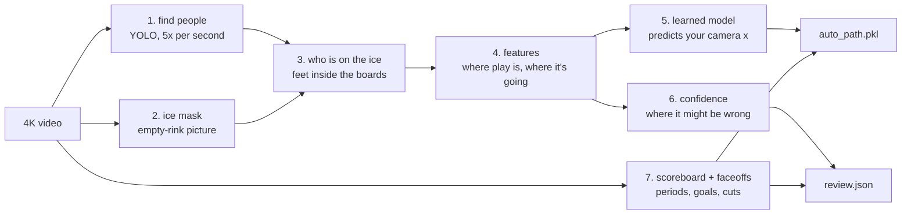

Steps 1–2 are the slow part: about 50 minutes per game on the RTX 4080. Their results are cached
in `DIR\autotrack_cache`, so every later re-run takes seconds.

---

## Step 0: what "camera x" means

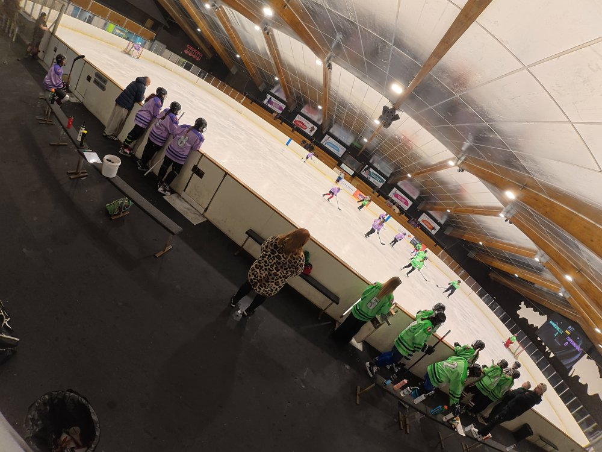

The camera is mounted rotated, so the rink runs corner to corner across the 3840×2880 frame
(above). Your app rotates the frame by `rotation` (37°) plus a small per-position tilt
(`angle_left` / `angle_right`). It then cuts out a 1920×720 window.

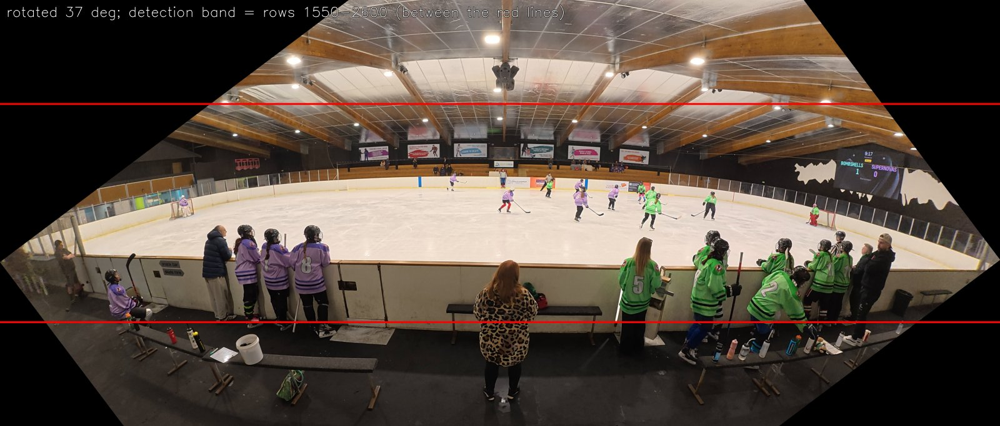

**Camera x** is the left edge of that window, from 0 (far left of the rink) to about 2819 (far
right). It's the one number you control when you track a game with the mouse, and it's the only
number autotrack has to produce. Camera y and the tilt follow from x through your calibration,
exactly as the app works them out.

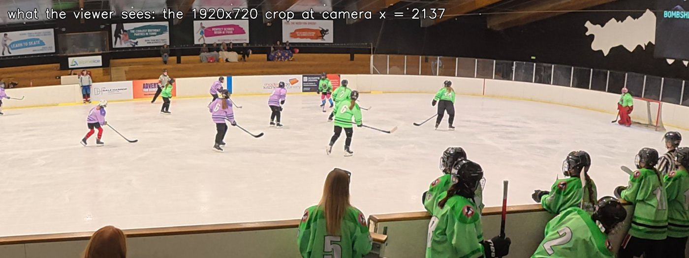

The red lines in the rotated picture mark the **detection band**: rows 1550–2600 of the rotated
frame. That's where the ice and the players are. Autotrack only ever looks inside it, which saves a
lot of work. The scoreboard happens to be inside the band too, which step 7 uses.

*Code:* `af/geometry.py` reproduces the app's crop exactly. It turns "a player at this column of
the rotated frame" into "the camera x that would centre on them", using each game's own
calibration.

---

## Step 1: find the people

Every 5th frame (5 times a second) is decoded on the GPU, rotated, and the detection band is cut
out at **full resolution** (4800 px wide). **YOLO11x**, an off-the-shelf person detector, runs on
it and returns a box around every person it sees. That includes players, referees, bench players,
coaches and spectators. All boxes are kept, along with how confident YOLO was in each.

At this distance players are small, often 40–60 px tall, so running at full resolution matters. A
smaller model or a downscaled picture misses many of them.

The same pass also saves a half-resolution video of the band (the "proxy"). All the images below
are drawn on it, and the scoreboard is read from it.

*Code:* `af/extract_dets.py`. *Cache:* `autotrack_cache\dets\` (one `.npz` of boxes plus one
`_band.mp4` proxy per video file).

---

## Step 2: the ice mask, or which people count

Most boxes aren't skaters. To separate them, autotrack first works out where the ice is.

**An empty rink.** It takes 31 frames spread across one video file and, for each pixel, keeps the
*median* colour. Players move and the ice doesn't, so they mostly vanish:

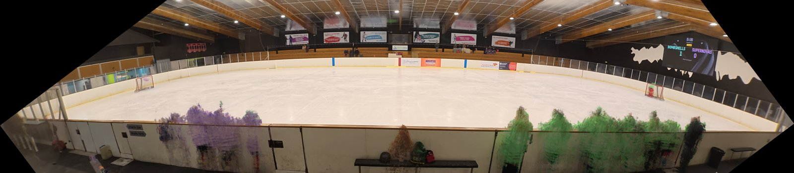

The people standing at the boards don't vanish, because they barely move. You can see their
ghosts along the near boards.

**The boards lines.** The ice is the big bright, grey-white region. For every column, autotrack
finds the top edge of the ice (the far boards) and the bottom edge (the near boards). It then fits
smooth curves through those edges. The ghosts can only make the ice look *smaller*, never bigger,
so the curves are pushed to the outside of the measured points. Both curves are then extended past
the nets.

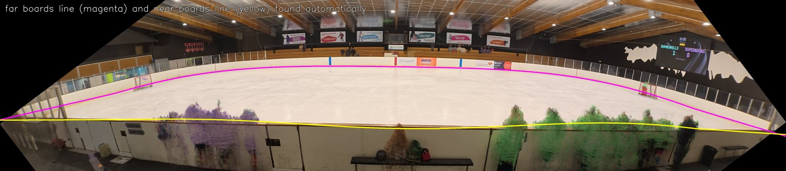

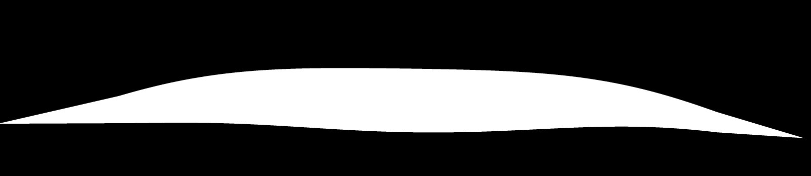

**The on-ice rule.** A person counts as a skater when:
- their **feet** (the bottom-middle of the box) are between the two lines, with 15 px of slack at
  the far boards and 30 px at the near boards;
- YOLO is at least 25% sure;
- the box is at least 20 px tall.

Spectators behind the far boards have their feet above the line. People on the bench side have
their feet below the near boards, or hidden by them.

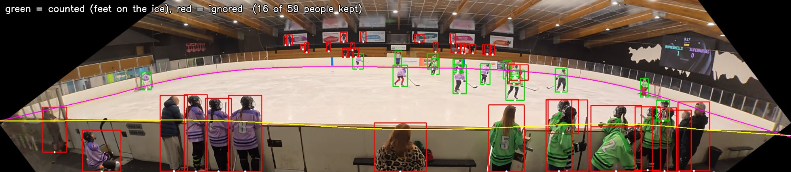

Here 16 of the 59 people found count as skaters. **It isn't perfect**, and the model has learned to
live with that:
- Referees count as skaters: they're on the ice.
- A bench player whose lower body is hidden by the boards can slip through. There's one at the
  top right of the bench group here.
- Two skaters overlapping can become one box.

The mask is built once per game, with no calibration needed.

*Code:* `af/icemask.py`, `af/players.py` (`on_ice`). *Cache:* `autotrack_cache\icemask\`.

---

## Step 3: from skaters to "where is the play"

For every sample (5 per second), the kept skaters become a list of camera x positions: the camera
x that would centre on each skater.

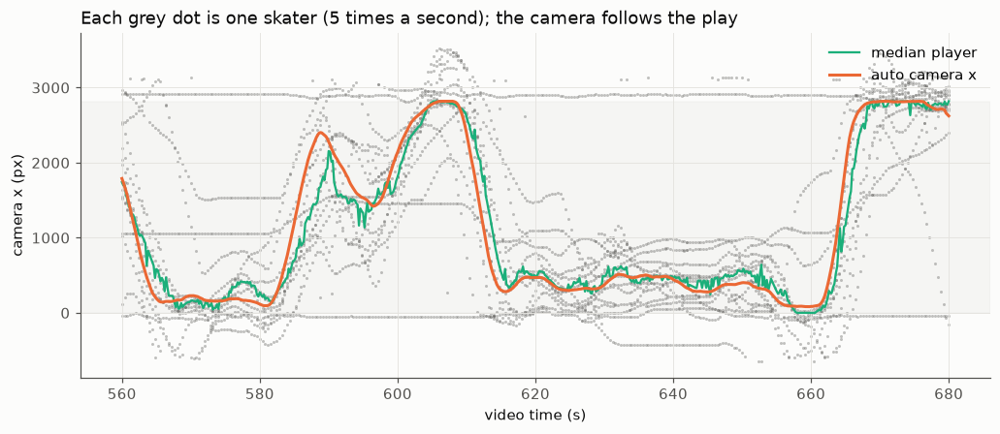

Each grey dot is one skater at one moment. The flat rows of dots near x ≈ −50 and x ≈ 2900 are the
**two goalies**, who barely move. The green line is the median skater. The orange line is the
camera autotrack chose.

The median skater alone is already a decent camera: about 260–270 px from your camera on
average. But it's always late, by about 0.8 s, and it never commits to an end the way you do.
So autotrack describes each moment with **167 numbers** (the "features") and lets a model learn
how you turn them into a camera position:

| Feature group | What it says |
|---|---|
| **Where the skaters are** | 10th / 25th / 50th / 75th / 90th percentile of skater x, a 12-bucket histogram across the rink, and the number of skaters. |
| **How they're moving** | Each skater is matched to the nearest skater 0.2 s later, giving their speed. Then: the average and median speed, the share moving fast left or right, the 3 fastest in each direction. |
| **Where the rush is** | The most advanced fast skater in each direction (the front of a breakout), a speed-weighted centre, the fastest skater's position. |
| **Context** | All of the above **8, 4, 2 and 1 s before and after** this moment, plus the median skater's movement over 1, 2 and 4 s, and where play has been over the last 10 and 20 s. |

The context is the key part. Autotrack runs *after* the game, so it can look a few seconds into
the future. That's how it can start moving with a breakout instead of after it, which a live
operator does by reading the play.

*Code:* `af/features.py`, `af/motion.py`. *Cache:* `autotrack_cache\features.npz`.

---

## Step 4: the learned model, or "what would you do here?"

The model is a **LightGBM** regression: a few hundred small decision trees whose answers add up.
It's trained on your **hand-tracked games** (2026-08-22 and 2026-08-15, 74 minutes of you
framing play). Every 0.2 s of those games gives one example: the 167 features as input, and your
camera x at that moment as the answer. It learns things like these:
- park deep in the zone when play is there, even if the median skater is further out;
- follow the leading skaters on a rush;
- stay put when play is bunched and slow.

It's trained to minimise the *absolute* error, which keeps it from being dragged by the rare
moments where you did something unusual. Its output is smoothed over 2 seconds, so the camera
doesn't jitter.

**How good is it?** The fair test is a game the model has never seen:

| Test | Average distance from your camera |
|---|---|
| Camera fixed at centre ice | 921 px |
| Follow the median skater | ~260–270 px |
| **Autotrack, on a game it never saw** | **~180 px** |
| Your own path, delayed 1 s | ~150 px |
| Your own path, delayed 2 s | ~300 px |

For scale, the crop is 1920 px wide. 180 px means the auto camera is usually within a tenth of a
screen of yours. It keeps the spot you'd have centred inside the frame about 99% of the time.

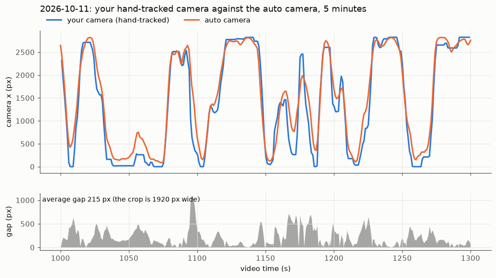

This is 2026-10-11, 5 minutes of your hand tracking against the auto camera; the model never
saw this game. Most of the time the two lines lie on top of each other. The gaps are typically:
- **breakouts**, where you jump to the play a moment earlier;
- **stoppages**, where you park and the model drifts with the skaters;
- **deep in a zone**, where you go all the way to the end and the model stops a little short.

For how the trees, boosting and settings work, see [LightGBM in autotrack: a deeper look](lightgbm-explained.md).

*Code:* `af/model.py` (and `af/transfer.py` for the cross-game test). *Model file:*
`models/autotrack_lgbm.txt`, retrained with `python autotrack.py train DIR [DIR ...]`.

---

## Step 5: writing the camera path

The model's answer, 5 times a second, becomes **one camera point per second**. Each point gets x;
y and tilt worked out from your calibration exactly as the app does; and `source = "auto"`. These
go into `auto_path.pkl`, together with the calibration used.

**Calibration** comes from the game's own pkl if you've set it up in the app. Otherwise it comes
from the defaults (the average of your calibrated games at this rink). If you change calibration
later, re-run autotrack. It takes seconds, because steps 1–2 are cached.

How the app uses it:
- **No camera path yet:** the app copies the sidecar in.
- **An auto path, and autotrack has been re-run since:** the app refreshes it. Your start (`T`),
  end (`Y`), cuts, re-recordings and goal decisions are kept, and a backup is saved first.
- **A path you recorded yourself:** the app never replaces it. That's what happened with
  2026-10-11 before you renamed the pkl.

*Code:* `af/export.py`, `af/pipeline.py`; in the app, `review.py` (`refresh_path`).

---

## Step 6: confidence, or where to spend your review time

Autotrack also estimates **how wrong it might be**, moment by moment, so you only watch those
parts.

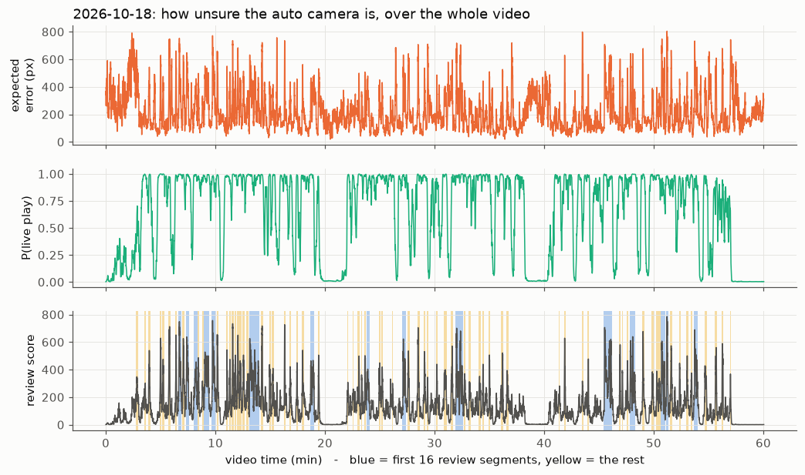

**Expected error** (top). A second model predicts the size of the camera model's mistake. Its
inputs are the camera model's features plus a few "how sure am I" signals:
- **disagreement:** extra versions of the camera model are trained, a cautious one and a bold one
  (quantile models) and five slightly different copies. Where they disagree, the answer is shaky;
- **speed:** fast camera moves are where transitions get missed;
- **evidence:** fewer or jumpier skater detections than usual.

It's trained the honest way: on one game's mistakes, made by a camera model that never saw that
game.

**P(live play)** (middle). A third model estimates whether you'd be framing play at all, rather
than an intermission, warm-up or long stoppage. You can see it drop to zero at both intermissions.
Without it, review time got wasted on stoppages.

**Review score** (bottom) = expected error × P(live play). Stretches in the top 20% become review
segments. Each one is padded by 2 s, joined with neighbours less than 5 s apart, and ranked.
They're shaded above: blue for the highest-ranked, yellow for the rest.

The app splits segments into **tiers** after you've set your start point: about 5 minutes of
video, then the next 5, then the next 10. In the two hand-tracked games, reviewing those passes
would have brought the average gap down like this:

| Minutes reviewed | Average gap from your camera |
|---|---|
| 0 | ~180 px |
| 5 | ~148 px |
| 10 | ~120 px |
| 20 | ~80 px |

This is what review mode looks like. The yellow lines are your progress per tier and the current
item; the strip under them is the whole game, with segments coloured by tier, green once reviewed,
and magenta for goals and cuts:

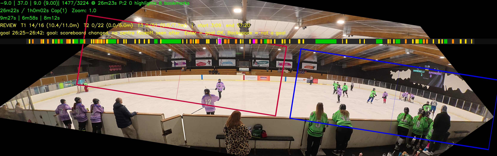

*Code:* `af/confidence.py`; in the app, `review.py` and `sportscam.py --review`. *Models:*
`models/review_*.txt`.

---

## Step 7: periods, goals and cuts

### The scoreboard

The rink's scoreboard is inside the detection band, so it's in the proxy video.

**Finding the clock.** Over 3 minutes of play, autotrack looks for pixels that change with a
strong **once-a-second rhythm**. Only the clock's seconds digits do that. On the right below,
bright means "changes every second". The single bright spot is the clock, found with no
calibration. The score digits sit at fixed offsets below it, the same for every game at this rink
(left: the three crops it reads).

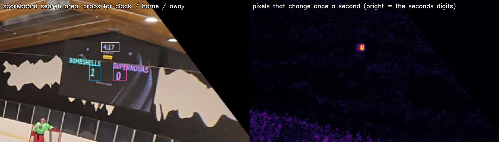

**Score changes.** Autotrack **doesn't read the digits**. It watches each score crop for a
**lasting change**: the picture 10 s later differs from 10 s earlier, while each side is steady.
Each change counts as one goal for that side, starting from 0-0.

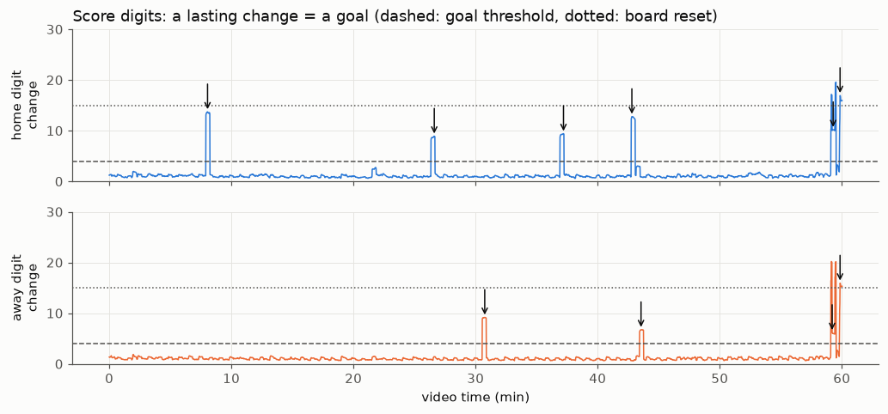

The 2026-10-18 board had 4 home and 2 away goals; each one is a clear step (arrows). The big jumps
at the very end are the board being reset after the game. They're ignored because they're outside
the game window and too big to be a score change.

### Periods

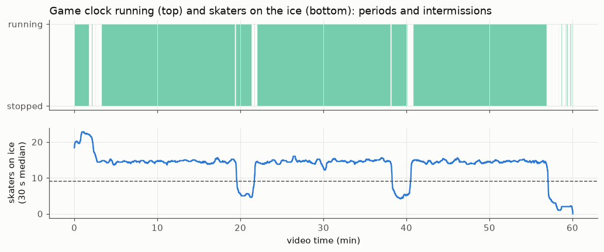

A **period** is the game clock running *with skaters on the ice*, for at least 8 minutes, with
short gaps (under 2 minutes) joined up. The board also runs a countdown during intermissions,
but the ice is nearly empty then (bottom plot), so that doesn't count. If the board can't be
found, autotrack falls back to the skater count alone: an intermission is a minute or more of
nearly empty ice.

Each gap between periods becomes an **intermission cut suggestion** in review. Enter applies it.

### Faceoffs and goals from the play

The board can be wrong, late or off, so goals are also detected from the play:

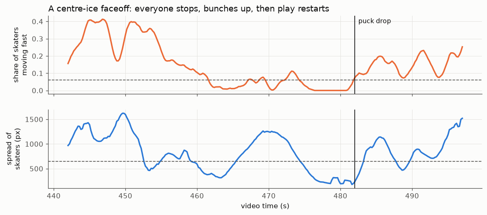

A **faceoff** is a few seconds where almost nobody is moving fast (top) and the skaters are
bunched together (bottom), ending when the puck drops and play takes off. Its position is where
the group stands.

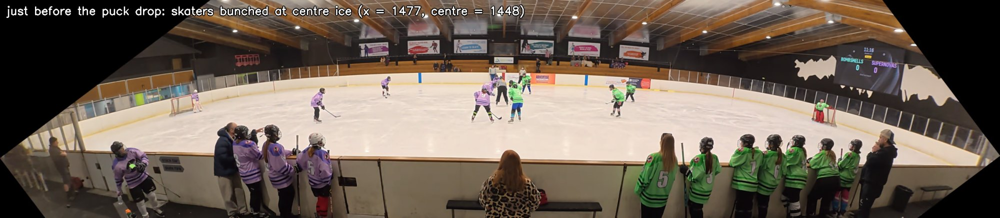

A **centre-ice faceoff** happens after a goal or at the start of a period. So a centre faceoff
that isn't a period opener, following play in one end zone, is a goal. The end tells which team
scored, the same way the app's middle-click does, including the period-2 switch of ends.

### Putting them together

| Board says | Play says | Result |
|---|---|---|
| goal | goal | **confirmed**: counted, nothing to review |
| goal | nothing | counted, and offered for review ("scoreboard changed, no centre faceoff seen") |
| nothing | goal | **not** counted, offered for review ("possible goal") |
| no board | goal | counted, and every one offered for review |

Any centre-ice faceoff that no goal or period start explains is also offered for review, as a
possible missed goal.

**How well does it work?**
- **2026-08-22:** all 7 goals found, and the score history matches yours exactly.
- **2026-08-15:** all 8 board goals found. Your log there missed two goals and had one double
  click.
- **2026-10-18:** all 6 found, 4-2, checked frame by frame against the board.

*Code:* `af/scoreboard.py`, `af/events.py`, `af/gameinfo.py`. *Cache:* `autotrack_cache\scoreboard.npz`.

---

## Known weak spots

- **Goal times can be late.** The scorekeeper often updates the board 20–40 s after the goal. In
  the faceoff picture above the board still reads 0-0 at the centre faceoff that *followed* the
  goal. Bookmarks use the board's time, so they can land late. (Using the play's time for
  confirmed goals would fix this; it's a small change.)
- **Digits are counted, not read.** A board correction (a goal taken off) looks like another goal.
  It's offered for review unless the play confirms it.
- **One rink.** The detection band, the scoreboard offsets and the defaults all assume your home
  rink and mount. The clock itself is found automatically wherever it is.
- **Detection mistakes** (step 2) feed straight into the features. The model copes with
  occasional ones, but a game with many people standing at the boards near the ice will be
  harder.
- **The model only knows how *you* frame.** It learned from two games. More hand-tracked games
  should keep improving it slowly; `autotrack.py train` retrains it.
- **No zoom.** Autotrack only produces x at zoom 1.0.

---

## Where things live

| What | Where |
|---|---|
| Run it | `python autotrack.py DIR` (or option 4 in the app's start-up menu) |
| Retrain | `python autotrack.py train DIR [DIR ...]` (folders with hand-tracked game pkls) |
| Pipeline steps | `af/pipeline.py` |
| Geometry (camera x, the crop) | `af/geometry.py`, `af/calibration.py` |
| Detection, ice mask, skaters | `af/extract_dets.py`, `af/icemask.py`, `af/players.py` |
| Features, model | `af/features.py`, `af/motion.py`, `af/model.py` |
| Confidence, review list | `af/confidence.py` |
| Scoreboard, faceoffs, goals | `af/scoreboard.py`, `af/events.py`, `af/gameinfo.py` |
| Review mode in the app | `review.py`, `sportscam.py` |
| Trained models | `models/` |
| Per-game cache (safe to delete; rebuilt on the next run) | `DIR\autotrack_cache\` |
| Development history and results | `docs/progress/` |
