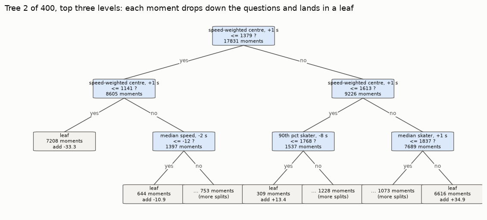
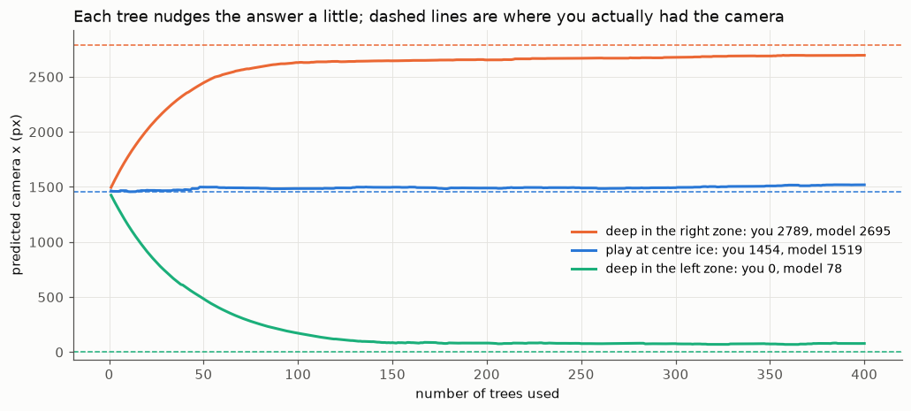
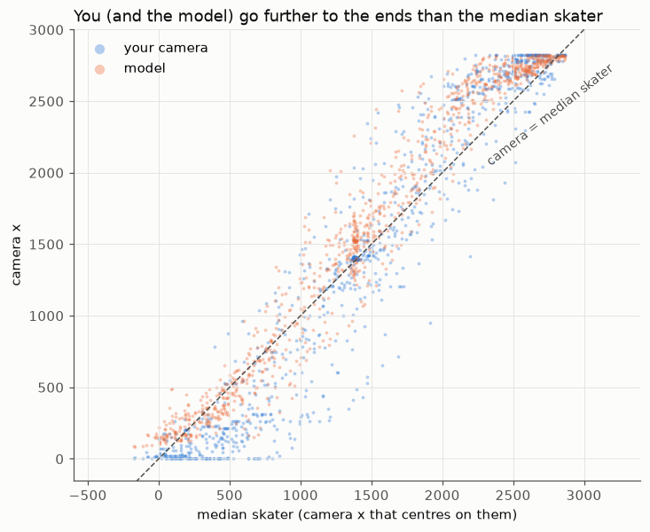
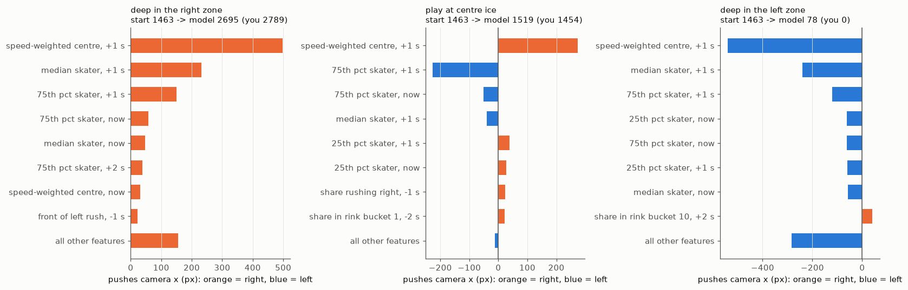
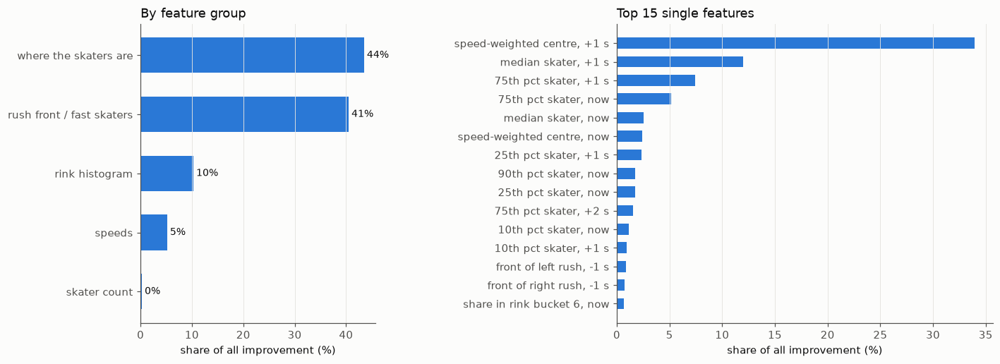
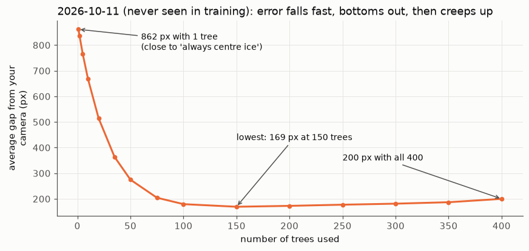

# LightGBM in autotrack: a deeper look

[How autotrack works](autotrack-explained.md) describes the whole pipeline. This document zooms in
on the part that turns "where the skaters are" into "where you would put the camera": a
**LightGBM** model. It covers:
- what the model is;
- how it learns from your hand tracking, and how it produces an answer;
- what each setting does;
- what it relies on;
- how it's tested, and where it could improve.

The charts use the real trained model (`models/autotrack_lgbm.txt`). The test charts use game
**2026-10-11**, scored against the 11 minutes you tracked by hand there. The model never saw that
game.

---

## 1. The job, in one sentence

> Given 167 numbers describing the play around one moment, output one number: the camera x you
> would have chosen.

The 167 numbers (the **features**) are described in the main explainer: where the skaters are,
how fast they're moving, where the front of a rush is, and the same a few seconds before and
after. The answer (the **label**) during training is your camera x at that moment.

The training data is every 0.2 s of the two games you tracked by hand: 2026-08-22 and 2026-08-15.
That's **22,238 moments**, about 74 minutes of you framing live play. Stoppages and intermissions,
where you weren't recording, are left out.

---

## 2. One decision tree

A decision tree is a flowchart of yes/no questions about the features. Every moment starts at the
top, answers one question at each box, and ends in a **leaf**. The leaf says how much to add to
the answer.

This is the top of tree 2, one of the 400 trees in the model. Read it like this:
- **First question:** "will the speed-weighted skater position, 1 second from now, be at camera x
  1379 or less?" That's roughly "is play about to be left of centre?"
- **"Yes", then "at 1141 or less" again:** a leaf covering 7,208 moments. It says "move the
  camera 33 px left".
- **"No", then "no":** play is heading clearly right, and a different leaf says "move 35 px right".

The deeper boxes are the finer cases, such as "the 90th-percentile skater 8 seconds ago" or
"median speed 2 seconds ago".

The leaf amounts look small, about 30 px, because they already include the 3% learning rate
explained in section 3. The full correction this tree "wanted" was about 1,100 px.

**How a tree picks its questions.** While training, LightGBM tries every feature and many possible
thresholds. It keeps the question that best separates moments where you were further right from
moments where you were further left; that measure is called the **gain**. Then it does the same
again inside each branch. Each tree here stops at **15 leaves**.

One tree on its own is crude: 15 possible answers for every situation in hockey. The power comes
from adding many of them up.

---

## 3. Boosting: many small trees, each fixing the last ones' mistakes

**Gradient boosting** builds the trees one after another:

1. **Start with a constant:** the middle of your camera positions, x ≈ 1460, about centre ice. On
   its own that's 860 px from your camera on average.
2. **Build tree 1** to correct the remaining errors: push right where you were right of 1460, left
   where you were left.
3. **Add only a small fraction** of tree 1's correction, set by the **learning rate** (here 3%).
   Then look at what's still wrong.
4. **Build tree 2** to correct *those* errors, add 3% of it, and so on, **400 times**.

Here are three real moments from 2026-10-11, showing the answer after 1, 2, 3 … 400 trees:
- **Deep in the right zone:** you had the camera at 2789. The answer climbs from 1460, gets most of
  the way within 100 trees, and ends at 2695.
- **Deep in the left zone:** you were at 0. It ends at 78.
- **At centre ice:** it barely moves from the start.

**Why only 3% at a time?** Taking small steps means no single tree can force a big, confident
change from a pattern it happened to see in the training games. A feature has to keep earning its
place across many trees. It's slower to train, a few seconds here, but much less likely to
memorise quirks.

**The error being minimised: absolute error (L1).** The model is trained to minimise the
*average distance* from your camera, not the average *squared* distance, which is the usual
choice. Squaring makes big misses count hugely. Your path has some legitimate big jumps, like
snapping to the other end on a turnover or a quick pan, and squared error would bend the whole
model to chase them. With absolute error, each tree just learns the *direction* to push and by
how much in a typical case. Switching to it was the single biggest improvement in tuning: about
5 px on the cross-validation and 9 px on the held-out period.

---

## 4. What makes it "Light"

LightGBM is a particular, fast implementation of gradient boosting (from Microsoft). Two tricks
make it fast:

- **Histogram binning.** Before training, every feature is cut into at most 255 buckets. A split
  search then only has to try bucket edges, not every distinct value. With 22,238 moments × 167
  features, that's the difference between seconds and minutes.
- **Leaf-wise growth.** Most tree libraries grow level by level: every box splits, then every box
  below splits. LightGBM always splits whichever leaf will improve the model most. Trees come out
  lopsided: deep where the situation is subtle (play near the blue lines), shallow where it's
  obvious (play deep in an end). For the same number of leaves that's more accurate. It can also
  overfit faster, which is why the leaf count is capped at 15 and each leaf needs 40 moments.

Training the camera model takes about **5 seconds** on the CPU. Predicting a whole game takes well
under a second.

---

## 5. The settings, one by one

These are in `af/model.py` (`PARAMS`):

| Setting | Value | What it means | Why this value |
|---|---|---|---|
| `objective` | `l1` | minimise absolute distance from your camera | robust to your occasional big swings (section 3) |
| `n_estimators` | 400 | number of trees | enough for the error to stop falling on the training games (see section 8) |
| `learning_rate` | 0.03 | each tree adds 3% of its correction | small steps generalise better; needs more trees |
| `num_leaves` | 15 | answers per tree | small trees, so each one captures one simple pattern |
| `min_child_samples` | 40 | a leaf must cover at least 40 moments (8 s of play) | stops a leaf memorising one odd moment |
| `subsample` / `subsample_freq` | 0.8 / 1 | each tree trains on a random 80% of moments | that's why the tree above shows ~17,800 moments, not 22,238; adds variety, reduces overfitting |
| `colsample_bytree` | 0.7 | each tree may only use a random 70% of the features | stops every tree leaning on the same top feature; makes the model use backups |
| `reg_lambda` | 1.0 | shrinks leaf values slightly towards zero | mild extra caution for leaves with few moments |

These were tuned on game 2026-08-22 with honest cross-validation (section 8). Most of them barely
mattered: changing leaves, child size or the time offsets moved the error by about 3 px either
way. Only the L1 objective made a clear difference.

---

## 6. How it learned your style

### Further to the ends than the skaters

Each dot is a moment in 2026-10-11, placed by where the median skater was (across) and where the
camera was (up). If the camera simply followed the median skater, every dot would sit on the
dashed line.
- **Your camera (blue)** bends away from the line at both ends. When play is in a zone you go all
  the way to the end, often right to 0 or 2819, while the median skater is still 300–800 px away.
- **The model (orange)** has learned that bend. It also shows its known weakness: at the left end
  it stops 100–300 px short of where you'd go.

### Why it chose a particular x

LightGBM can split any single prediction into **contributions from each feature**: how many pixels
each one pushed the camera right or left. These add up exactly: start value + all contributions =
answer. The method is called TreeSHAP.

The same three moments as in section 3:
- **Deep in the right zone:** almost all the push comes from "where will the play be in 1 second":
  the speed-weighted centre (+500 px), the median skater (+230) and the 75th-percentile skater
  (+150). They all agree.
- **Centre ice:** the features argue. The fast skaters 1 s ahead pull right (+280); where the
  pack's right-hand side is pulls left (−230). The net result is a small nudge.
- **Deep in the left zone:** the mirror image of the first.

---

## 7. What it relies on

This is the share of all the improvement the 400 trees made, credited to each feature (gain
importance). It shows:
- **"1 second ahead" dominates.** The top three features are all measured 1 s in the future. This
  is the advantage of working after the game: the model sees a moment of the future, which lets it
  start moving *with* play instead of after it. It's how it can match an operator who reads the
  play.
- **Speed-weighted position matters more than plain position.** Skaters who are moving fast pull
  hardest, which is roughly "follow the puck carrier and the chasers".
- **The rink histogram (10%) and raw speeds (5%) are supporting players.** The number of skaters
  hardly matters at all.
- Percentages are about *this* trained model. A feature with low importance may still help as a
  backup, because each tree only sees 70% of the features.

---

## 8. Testing it honestly, and a hint for improvement

**The trap.** Moments 0.2 s apart are almost identical. If you train on a random 80% of moments and
test on the other 20%, every test moment has a near-twin in training, and the score looks
wonderful but means nothing. So autotrack's tests never do that:
- **Grouped cross-validation:** each game is cut into your framed stretches between stoppages.
  Whole stretches are held out, so the model is tested on play it never saw.
- **Cross-game:** train on one game, test on the other. This is the real "new game" number:
  about **180 px**.

**Error against number of trees, on a new game:**

On 2026-10-11, which the model never saw:
- With 1 tree, the answer is basically "centre ice" (860 px off).
- The error drops fast and **bottoms out at about 150 trees (169 px)**.
- Then it **creeps up to 200 px at 400 trees**.

That pattern is mild **overfitting**: after about 150 trees, the extra trees learn details of the
two training games that don't carry over to this one.

**What that suggests, with caution.** Fewer trees (around 150–200), or slightly stronger caution
(bigger `min_child_samples`), might generalise better. But this is 11 minutes of one game,
including stretches where you'd paused. Before changing anything it should be checked properly,
across all three hand-tracked games (train on two, test on the third, each way round). That
needs detection re-run for 2026-08-22 and 2026-08-15, because their caches went with `D:\temp`:
about 50 minutes each with `python autotrack.py <folder>`. It's a cheap experiment once that's
done.

---

## 9. Why LightGBM and not a neural network

A neural network was tried: a temporal convolutional network that looks at the feature sequence
directly. It scored **206 px against LightGBM's 177** on the same test, and blending the two
didn't help. The reasons fit this problem:

- **Small data.** 74 minutes of labels, and neighbouring moments are nearly duplicates. Boosted
  trees cope with that much better than networks, which need far more examples.
- **Messy inputs are fine.** Trees don't care about scale (pixels against fractions against
  counts) or odd distributions, and they handle missing values natively.
- **Fast and simple.** Seconds to train on the CPU, no GPU, deterministic, a 600 KB file.
- **Inspectable.** Everything in this document (the trees, the contributions, the importance) is
  possible because it's trees.

The trade-off is that a tree model only knows the features it's given. It can't discover a new
cue on its own, like the puck itself or a player's stance. New cues have to be added as features.

---

## 10. The other LightGBM models in autotrack

The confidence and review step (main explainer, step 6) reuses the same machinery with different
**objectives**:

| Model | Objective | Answers |
|---|---|---|
| camera model | `l1` | where would you put the camera? |
| q10 / q90 models | `quantile` (alpha 0.1 / 0.9) | a cautious low and high guess; their spread says how unsure the camera is |
| 5 ensemble models | `l1`, each with a different random seed, 60% of moments and 50% of features | slightly different opinions; their disagreement is another "unsure" signal |
| error model | `l2` (squared error) | how far off is the camera model likely to be here? |
| live-play model | `binary` (yes/no) | would you be framing play now, or is it a stoppage or intermission? |

All of them are in `models/` (`review_*.txt`) and are retrained by `autotrack.py train`.

---

## 11. Retraining

`python autotrack.py train DIR [DIR ...]` takes any folders that have **hand-tracked** game pkls,
and their detection caches. It builds the features, and fits the camera model and the review
models on all the labelled moments together. It writes `models/autotrack_lgbm.txt` and
`models/review_*.txt`. The fitting takes under a minute; detection for a folder without a cache
takes about 50 minutes first.

**More games help in two ways:**
- more examples of rare situations, like breakouts, odd stoppages and empty-net play;
- less overfitting to the habits of particular games.

In testing, adding the other game's labels improved each game's score by 3–5 px. Expect slow,
steady gains rather than a jump.

To check a new model: `python -m af.transfer DIR=CACHE DIR=CACHE ...` prints the cross-game
scores, the "new game" numbers.

---

## Glossary

| Term | Meaning |
|---|---|
| **feature** | one of the 167 input numbers describing a moment |
| **label** | the answer during training: your camera x |
| **decision tree** | a flowchart of yes/no feature questions ending in leaves |
| **leaf** | the end of a tree path; holds the amount to add |
| **gain** | how much a split improves the model; used to choose splits and to rank features |
| **boosting** | adding trees one at a time, each correcting the previous ones' errors |
| **learning rate** | the fraction of each tree's correction that's actually added |
| **L1 / L2** | absolute / squared error: what training tries to make small |
| **overfitting** | learning details of the training games that don't carry over to new ones |
| **cross-validation** | testing on data held out from training; here held out by whole stretches or whole games |
| **TreeSHAP contributions** | an exact split of one prediction into per-feature pushes |
